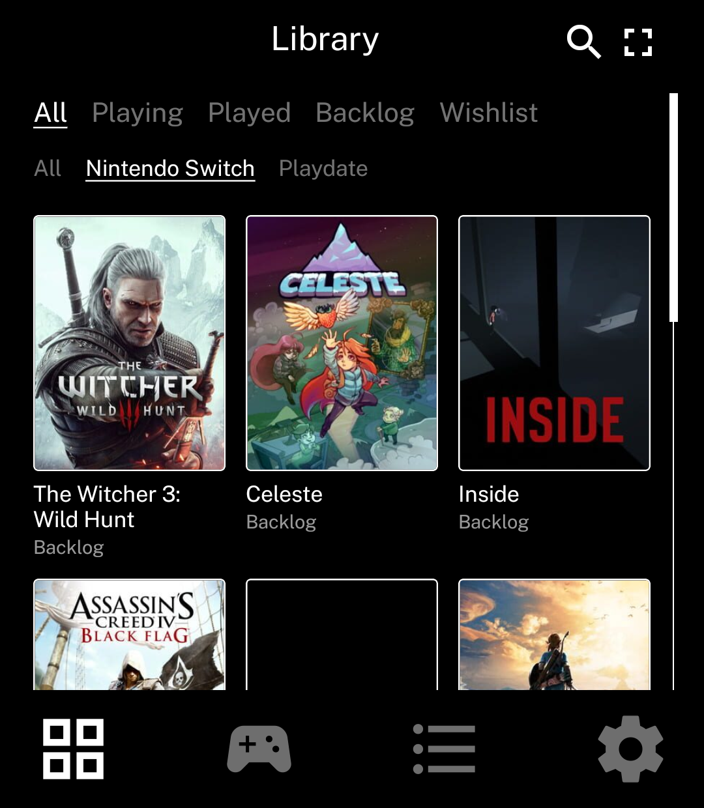
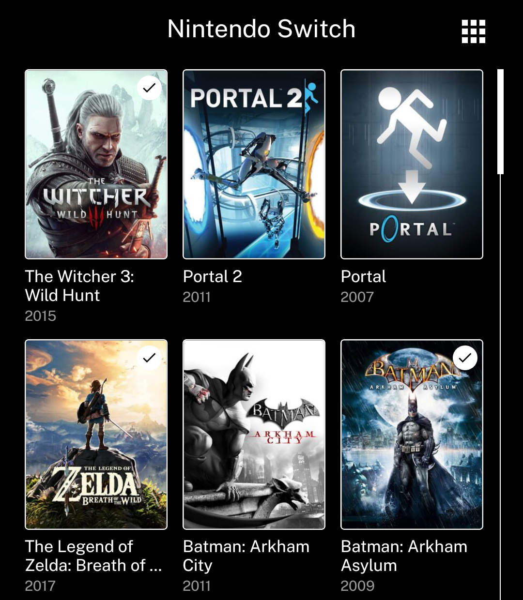
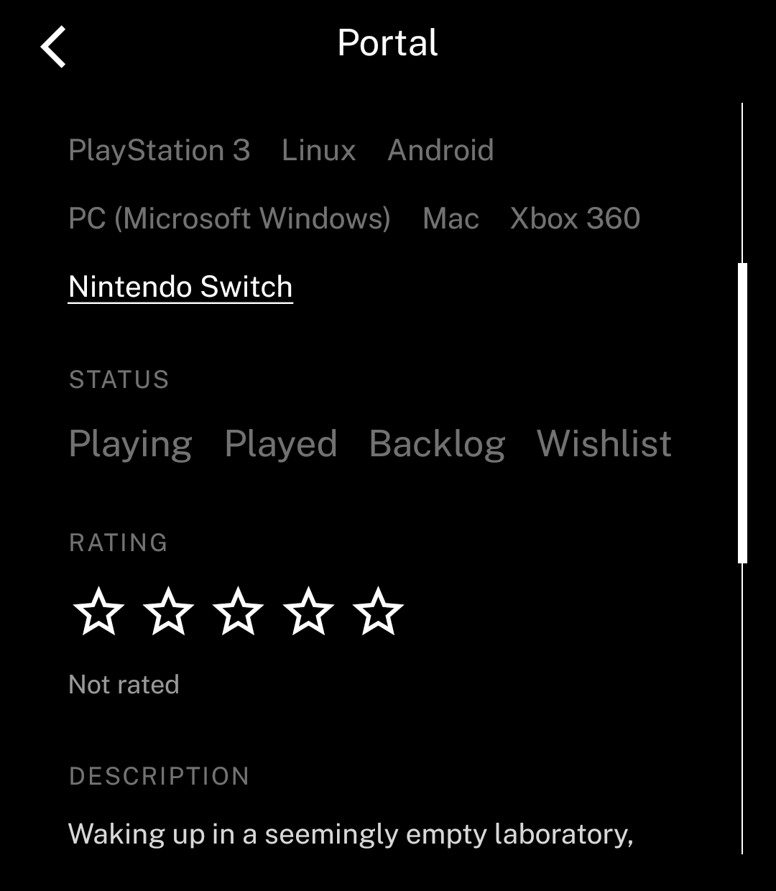
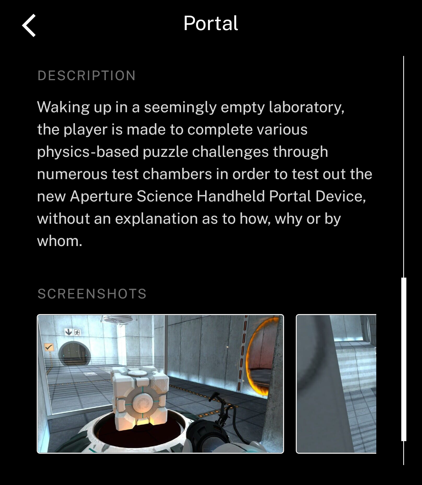
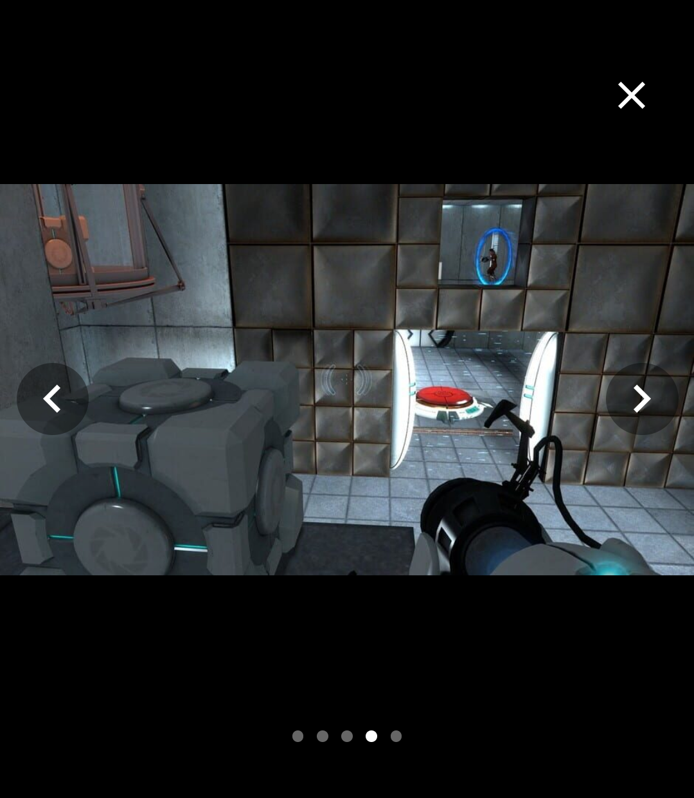

# Backlog

A minimal, **LightOS-inspired video game tracker for the Light Phone III** — a
stripped-down [Backloggd](https://backloggd.com) experience. Track your games by
status, rate them, browse by console, write them into custom lists, and read
game descriptions & screenshots — all in a distraction-free black & white
interface. Game data comes from [IGDB](https://www.igdb.com) (by Twitch).

Built on top of [light-template](https://github.com/vandamd/light-template)
(Expo + expo-router).

## Screenshots

<p align="center">
  
  
  
</p>
<p align="center">
  
  
</p>

## Features

- **Library** — your collection, filterable by **status** (Playing / Played /
  Backlog / Wishlist) and by **console**. Both filters are remembered. A
  **full-screen grid** mode hides the chrome for a pure cover wall.
- **Ratings** — half-star ratings, kept monochrome to match the LightOS look.
  The game page also shows the IGDB scores (overall, users, critics), and the
  library and lists can be sorted by your rating or by IGDB rating.
- **Games** — browse popular titles **by console** (PlayStation, Xbox, Nintendo,
  Sega, PC, retro & arcade — Switch 2, Playdate, Game Boy, Neo Geo…). Endless
  scroll, and the chosen console is remembered between sessions.
- **Quick add** — double-tap a cover in a console's grid to add/remove it
  instantly (tagged with that console); a ✓ badge marks games already in your
  library.
- **Per-console filing** — when adding a game you pick which of *its* available
  consoles to file it under, Backloggd-style. The choice is remembered.
- **Search** — find any game in the IGDB database and add it to your library,
  optionally restricted to one or more consoles (the filter is remembered).
- **Game detail** — cover, platforms, status, rating, **description**
  (auto-translated to French when the app is in French) and a **full-screen
  screenshot viewer** (swipe, rotate, tap for controls).
- **Lists** — create custom lists and add games to them. Each list can pick
  its own sort (A-Z, Z-A, recently added, IGDB rating) from a row under its
  consoles; lists without a choice follow the global setting.
- **Import** — paste or pick a list of titles (one per line, Markdown or
  CSV) to build a list in one go. Each title is looked up on IGDB restricted
  to the list's consoles, and the main game is preferred over DLCs, bundles
  and special editions. A year or console after a title settles ambiguous
  ones (`Doom (2016)`, `Halo (Xbox)`, `God of War - PS4`), and the import
  ends with the titles that were not found or are worth a check.
- **Backup** — export everything (library, lists, settings) to a single JSON
  file from Settings, and restore it on any device.
- **Sync (optional)** — keep the same library and lists on several devices
  through your own server (see [Sync](#sync)). Off by default.
- **Bilingual** — English / French, switchable in Settings (defaults to the
  device language).
- Covers and screenshots are shown in colour; everything else stays minimal
  black & white.

## IGDB credentials

Search and browsing need free IGDB credentials (a Twitch application):

1. Go to <https://dev.twitch.tv/console/apps/create> and register an app
   (any name; OAuth redirect URL `https://localhost`; client type
   **Confidential**).
2. Copy the **Client ID** and generate a **Client Secret**.
3. In the app: **Settings → IGDB Credentials**, paste both, and save.

Credentials are stored on-device with `expo-secure-store` and never leave it.
Your library and lists are stored locally (`AsyncStorage`) and work offline.
They stay on the device unless you set up a sync server.

Without credentials, the app goes through your sync server if one is set
(see [Sync](#sync)): the server queries IGDB with its own keys. Credentials
entered in the app always come first.

> French descriptions are produced by machine-translating the (English-only)
> IGDB summary through a free, keyless service — the summary text is sent to
> that service for translation. It falls back to English if unavailable.

## Sync

Sync is off by default, and there is no public server: without one, the app
makes no sync request. To keep the same library and lists on several devices,
point the app at a server of your own in **Settings → Sync**: its HTTPS
address and its token. The token is stored with `expo-secure-store`.

- The app syncs when it opens, when it comes back to the foreground, when you
  arrive on the Library, Games, Lists or a list (at most every 30 seconds), a
  few seconds after a change to the library or the lists (a burst of changes
  makes one sync, sent at once if you leave the app), and with **Sync now**.
- Offline, or while the server wakes up, changes wait. As long as the app
  stays in the foreground, a failed sync is tried again after 30 seconds,
  1 minute, 2 minutes, then every 5 minutes, until it goes through or nothing
  waits. There is no other periodic sync, so that the server's database can
  sleep.
- The library and the lists sync, with their sort, consoles and order. The
  other settings stay on each device.
- For each game, list or game in a list, the most recent change wins, so
  devices need their clock on time.
- Before the first sync, the app keeps a copy of its data, which **Restore the
  copy** puts back (turning sync off).
- **Disconnect** turns sync off: the data stays on the phone. Restoring a
  backup also turns sync off.
- Without IGDB credentials in the app, search and browsing go through the
  server: `POST /api/igdb/<endpoint>`, with the Apicalypse query as the body
  and the same token (see `core/igdb.ts`).

The protocol (one `POST /api/sync`, a bearer token and a version number) is
described by its types and checks in [`core/sync.ts`](core/sync.ts), and the
app's side in [`core/syncClient.ts`](core/syncClient.ts). It is made for one
server and comes with no promise of stability for others.

## Install (APK)

Grab the latest `app-release.apk` from the
[Releases](https://github.com/Alexis-NM/light-backlog/releases) page and install
it over USB:

```bash
adb install -r app-release.apk
```

The release APK is signed with the Android **debug** key — fine for personal
sideloading, not for the Play Store.

## Development

Requires [Bun](https://bun.sh) and the Android SDK. The native build needs
**JDK 17** (React Native 0.83).

```bash
bun install
bun dev          # build the debug app and run it on a device/emulator
```

The `android/` and `ios/` folders are **not** committed — they are generated
from `app.json` and the config plugins by `expo prebuild` (or by EAS in CI).

The logic that does not depend on React Native or Expo (data types, IGDB
client, list import, backup format, translations, consoles) lives in `core/`:
plain TypeScript with no dependency, whose files import each other with
relative paths (`bun run check` enforces both).

To produce a standalone, installable APK locally:

```bash
bunx expo prebuild --platform android   # generates android/
cd android
JAVA_HOME=<path-to-jdk-17> ./gradlew assembleRelease
# → android/app/build/outputs/apk/release/app-release.apk
```

### Commands

```bash
bun dev                # Build and run
bun run check          # Lint (ultracite / biome)
bun run fix            # Auto-fix lint issues
bun test               # Unit tests (list parser, import matcher)
bun run test:import    # Live IGDB run of the import matcher (see below)
bun run sync-version   # Sync version across files
bun run generate-icon  # Generate icon from app name
```

### Checking the list import against IGDB

`scripts/import-tests/*.json` hold sample lists (typed titles, the list's
consoles, and the game each title should resolve to). The script matches them
through the real API, prints every pick, and compares with the naive
"first search result" the import used before:

```bash
IGDB_CLIENT_ID=… IGDB_CLIENT_SECRET=… bun run test:import            # all lists
IGDB_CLIENT_ID=… IGDB_CLIENT_SECRET=… bun run test:import ps2        # one list
IGDB_CLIENT_ID=… IGDB_CLIENT_SECRET=… bun run test:import --no-baseline
```

Add a list (or an entry that went wrong for you) and re-run before touching
the scoring in `core/importMatcher.ts`.

## Releases (CI)

`.github/workflows/build.yml` generates the Android project with
`expo prebuild`, builds the release APK with Gradle and creates a GitHub
release on manual dispatch (Actions tab). No Expo account or secret is
needed. Alternatively, attach a locally-built `app-release.apk` to a release
by hand.

## Tech stack

Expo · expo-router · React Native · TypeScript · IGDB API (Twitch OAuth) ·
expo-secure-store · expo-screen-orientation · ultracite/biome.

## Detailed docs

See [AGENTS.md](./AGENTS.md) for the component reference and template patterns.
